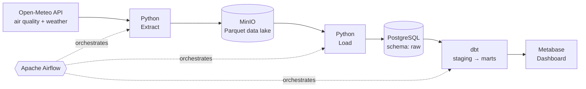
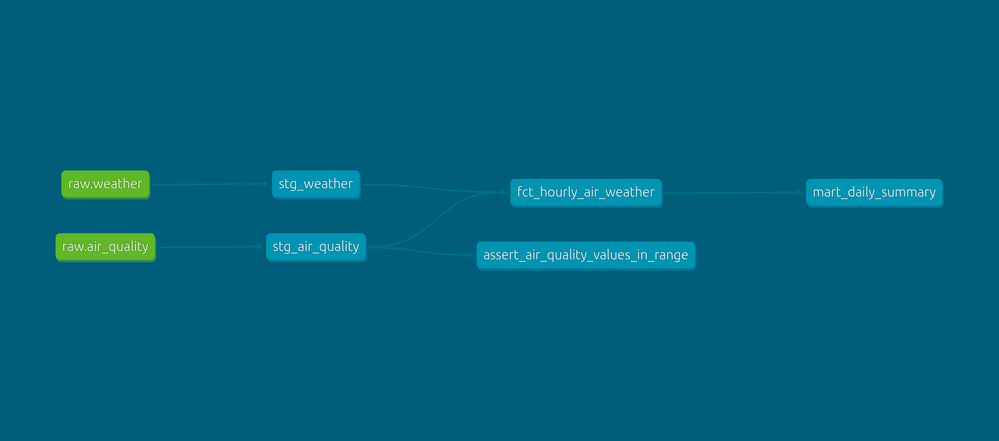

# Hanoi Air Quality Pipeline

An end-to-end data engineering project that collects hourly air quality and
weather data for Hanoi, stores it in a data lake, transforms it into
analytics-ready tables, and visualizes it on a dashboard.

## Overview

The pipeline pulls PM2.5, PM10, NO2, O3, US AQI, temperature, humidity, wind
and precipitation from the free [Open-Meteo API](https://open-meteo.com/) every
day. Raw data is saved as date-partitioned Parquet files in MinIO
(S3-compatible), loaded into PostgreSQL, and modeled with dbt following the
Medallion architecture (raw → staging → marts). Apache Airflow orchestrates
every step, and the whole stack runs locally with Docker Compose.

## Architecture



**Medallion layers**

| Layer | Location | Description |
|---|---|---|
| Bronze | MinIO + `raw` schema | Raw data exactly as received from the API |
| Silver | `staging` schema | Cleaned, typed, deduplicated |
| Gold | `marts` schema | Analytics-ready tables for the dashboard |

## Data Lineage



Lineage generated with `dbt docs generate`: raw → staging → marts.

## Tech Stack

| Layer | Tool |
|---|---|
| Source | Open-Meteo API |
| Data Lake | MinIO (Parquet) |
| Warehouse | PostgreSQL 16 |
| Transformation | dbt (dbt-postgres) |
| Orchestration | Apache Airflow 2.10 |
| BI | Metabase |
| Infrastructure | Docker Compose |
| Language | Python 3.11, SQL |

## Key Features

- Idempotent daily ingestion: re-running a day never duplicates data
- Partitioned Parquet storage in the data lake (`date=YYYY-MM-DD`)
- Medallion architecture: raw, staging, marts
- Automated data quality tests with dbt (`unique`, `not_null`)
- Scheduling and retry logic with Airflow
- Fully containerized and reproducible setup

## Project Structure

```
hanoi-air-quality-pipeline/
├── docker-compose.yml        # postgres, minio, airflow, metabase
├── Dockerfile.airflow        # Airflow image + pyarrow, boto3, dbt (in a venv)
├── .env.example              # template for environment variables
├── dags/                     # Airflow DAGs
├── scripts/                  # extract.py, load.py
└── dbt_project/              # dbt models, tests, profiles
    └── models/
        ├── staging/
        └── marts/
```

## Getting Started

### Prerequisites

- [Docker](https://www.docker.com/) with Docker Compose
- At least 8 GB RAM (16 GB recommended)
- Git

### Run locally

```bash
# 1. Clone the repository
git clone https://github.com/tuantimol/hanoi-air-quality-pipeline.git
cd hanoi-air-quality-pipeline

# 2. Create your environment file
cp .env.example .env

# 3. Start all services (first run takes several minutes)
docker compose up -d --build

# 4. Check that all services are running
docker compose ps
```

### Service URLs

| Service | URL | Login |
|---|---|---|
| Airflow | http://localhost:8080 | `admin` / see command below |
| MinIO Console | http://localhost:9001 | values from `.env` |
| Metabase | http://localhost:3000 | created on first visit |
| PostgreSQL | `localhost:5432` | values from `.env` |

Get the Airflow admin password:

```bash
docker compose exec airflow cat /opt/airflow/standalone_admin_password.txt
```

### Stop the stack

```bash
docker compose stop       # pause, keep data
docker compose down       # remove containers, keep data (volumes)
docker compose down -v    # remove containers AND data
```

## Project Status

- [x] Phase 1: Infrastructure with Docker Compose
- [x] Phase 2: Extract to the data lake (MinIO / Parquet)
- [x] Phase 3: Load into PostgreSQL
- [ ] Phase 4: Transform with dbt (staging, marts, tests)
- [ ] Phase 5: Orchestrate with Airflow
- [ ] Phase 6: Dashboard with Metabase
- [ ] Phase 7: CI with GitHub Actions and dbt docs

## Data Source

[Open-Meteo](https://open-meteo.com/) Air Quality and Weather APIs (free, no
API key required). Location: Hanoi (21.0285, 105.8542), timezone
`Asia/Bangkok`.

## Notes

- **MinIO image:** MinIO stopped publishing its official images on Docker Hub
  and Quay in September 2026. This project uses a community mirror of the last
  free release (`scnd/minio-mirror`). That release no longer receives security
  patches, so it is intended for local learning only and should not be exposed
  to the internet or used in production.
- **dbt** is installed in a separate virtualenv inside the Airflow image to
  avoid dependency conflicts with Airflow.
- Default credentials in `.env.example` are for local development only.

## Roadmap

- Alerting via Telegram/Slack when AQI is high or the pipeline fails
- Advanced data quality checks (Great Expectations / Soda)
- Add more cities (Ho Chi Minh City, Da Nang) for comparison
- Cloud deployment (S3 / BigQuery)
- Streaming ingestion with Kafka or Redpanda

